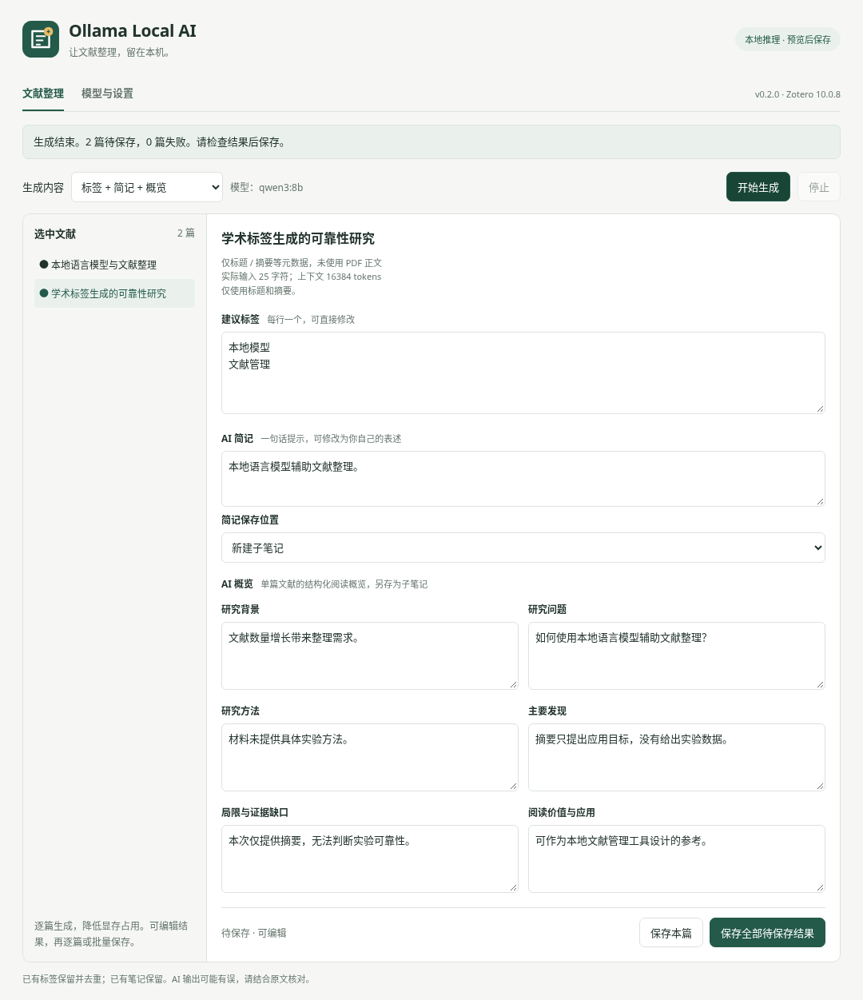

# Ollama Local AI · Zotero 本地标签、简记与概览

调用本机已部署的 Ollama，为选中的文献生成标签、一句话简记和结构化概览。支持预览编辑、逐篇生成、批量保存和取消。

当前为 **0.2.0 预览版**，兼容目标是 **Zotero 10.0.8 桌面版**，清单允许 `10.0.x`。其他主版本尚未声明兼容；验证范围见 [验证说明](docs/VALIDATION.md)。

**请使用 0.2.0 替代 0.1.0。** 旧版遗漏 Zotero 必需的 `update_url` 清单字段，会导致安装失败。新版补齐更新元数据，并增加打包回归检查。

下载：[XPI 安装包](https://github.com/kangweihou522-cmyk/zotero-ollama-local-ai/raw/refs/heads/main/downloads/ollama-local-ai-0.2.0.xpi) · [完整源码包](https://github.com/kangweihou522-cmyk/zotero-ollama-local-ai/raw/refs/heads/main/downloads/ollama-local-ai-0.2.0-source.zip) · [v0.2.0 预览版说明](https://github.com/kangweihou522-cmyk/zotero-ollama-local-ai/releases/tag/v0.2.0)。



## 可以完成什么

| 功能 | 内容 | 保存位置 |
| --- | --- | --- |
| AI 标签 | 文献主题、对象、方法等学术标签 | 追加到 Zotero 标签，保留已有标签并去重 |
| AI 简记 | 一句话短提示，默认要求约 15～40 个汉字 | 默认新建简记子笔记；可选同时写入 Style 简记栏 |
| AI 概览 | 单篇文献的背景、研究问题、方法、主要发现、局限、研究参考价值 | 独立的结构化概览子笔记 |

可单独生成任一项，也可生成“标签 + 简记”或全部三项。多选文献时逐篇处理，当前没有跨文献综合综述功能。缺失的信息应标为“材料未提供”，所有结果均可检查和修改后再保存。

本插件使用独立的 **“Ollama 本地 AI”菜单**。Style 原有“AI 生成标签／简记”菜单仍由 Style 与 Awesome GPT 处理；安装本插件不会自动改变原菜单的模型设置。

## 安装与使用

1. 安装并启动 [Ollama](https://ollama.com/)。桌面应用已在后台运行时无需重复启动；命令行方式为 `ollama serve`。
2. 运行 `ollama list` 查看本机已安装模型。没有模型时按内存、显存条件下载，例如 `ollama pull qwen3:8b`。插件不会代为下载模型。
3. 在 Zotero“工具 → 插件”的齿轮菜单选择“从文件安装插件…”，安装 `ollama-local-ai-0.2.0.xpi`，按提示重启。
4. 打开“工具 → Ollama 本地 AI → 模型与生成设置…”，填写原生 API 根地址 `http://127.0.0.1:11434`，检测连接、选择模型并保存。也可从 Zotero 设置中的“Ollama Local AI”进入。
5. 在文献库选中一篇或多篇文献，右键打开“Ollama 本地 AI”，选择生成内容并开始。
6. 检查、编辑结果，点击“保存本篇”或“保存全部待保存结果”。先用少量文献验证本机模型的效果。

可调整输出语言、标签数量、输入字符上限、模型上下文、请求超时、补充要求及简记保存位置。

## Style 简记栏互通

Style 简记存放在 Extra（“其他”）字段的 `remark: 文本` 行，是一句短提示，与较长的阅读笔记、结构化概览不同。[作者说明](https://github.com/MuiseDestiny/zotero-style/issues/1308)

默认只创建简记子笔记。选择同时写入 Style 的方式后，保存时新增或更新 `remark:` 行，同时保留简记子笔记。详细概览始终保存为另一篇子笔记。

- 只改目标行，保留 Extra 中的 DOI、引用键、评级及其他内容。
- 已有非空简记默认保留，须在该篇预览中勾选允许更新后再保存。
- 如果生成后原简记被其他操作修改，保存会停止并提示。
- 多条 `remark:` 会导致可选字段写入被拒绝，需先人工整理；仍可选择普通子笔记方式。

互通使用通用 Extra 数据约定，不修改 Style 代码或私有缓存。具体显示效果取决于安装的 Style 版本。

## 保留 Style 原有 AI 菜单，直接调用 Ollama

作者公开的调用链为 **Style → Awesome GPT → 模型接口**，标签与简记依据摘要或 PDF 第一页。可以在 Awesome GPT 中配置本地 Ollama 的 OpenAI 兼容接口，继续使用原菜单。[作者用法](https://github.com/windingwind/zotero-actions-tags/discussions/519)

| Awesome GPT 设置 | 填写内容 |
| --- | --- |
| 协议 | OpenAI Chat |
| Full URL | 开启 |
| API 地址 | `http://127.0.0.1:11434/v1/chat/completions` |
| API Key | 非空占位值 `ollama` |
| Model | `ollama list` 中的完整模型名称 |

不同版本入口可能不同。先测试普通对话，再测试 Style 标签与简记。非空 Key 的本地使用实例见 [Awesome GPT issue 472](https://github.com/MuiseDestiny/zotero-gpt/issues/472#issuecomment-3345029250)。AskPDF 等检索功能可能还需要 embedding 接口，不能把聊天模型当作 embedding 模型。

**两处地址填法不同：** 本插件填写根地址 `http://127.0.0.1:11434`；Awesome GPT 上表填写完整的 `/v1/chat/completions` 地址。两处设置相互独立。

参考：[作者 API 文档](https://plugins.muisedestiny.xyz/docs/gpt#api)、[Ollama 兼容说明](https://github.com/ollama/ollama/blob/main/docs/api/openai-compatibility.mdx)。本次开发环境无法直接访问作者文档，配置字段另经官方发布包的公开设置页和作者说明核对，仍需在用户具体版本上验证。

## 材料、保存与同步

输入包含标题、摘要、作者、日期、期刊、DOI 和已有标签。启用 PDF 选项后，读取至多两份 PDF 的 **Zotero 本地全文索引缓存**。插件不自动下载附件，不执行 OCR，也不建立新索引。索引可能只覆盖部分页面，有缓存不代表已读完全文；没有正文时提示仅使用元数据和摘要。

输入上限默认 24,000 字符，上下文默认 16,384 tokens。插件遵守模型公布的上下文上限，为提示词和输出预留空间，并按 UTF-8 字节预算保守截取材料。实际输入可能短于字符上限。界面和子笔记保留来源、索引覆盖和截断提示；更大上下文通常占用更多内存。

生成只产生预览，点击保存后才写入。标签、简记和概览均可编辑；保存新增相应子笔记，保留已有笔记。当前窗口的已保存结果不能重复保存。停止会取消当前请求并停止后续条目，已完成结果仍可保存。

选中附件或子笔记时使用其所属文献并去重，独立附件和笔记不会作为文献处理。保存前重新检查条目存在性和库写权限。

本插件仅允许 `localhost`、`127.0.0.1`、`[::1]` 本机回环地址，使用 Ollama 原生 `/api/tags`、`/api/show`、`/api/chat`，无需 API Key。禁止重定向，并拒绝已识别的云模型和云端别名。模型下载由 Ollama 管理；保存后的标签、Extra 和笔记仍遵循 Zotero 同步设置。

## 常见问题

| 现象 | 处理方式 |
| --- | --- |
| 0.1.0 安装失败 | 改用 0.2.0，旧版缺少必需更新地址。 |
| 0.2.0 仍提示不兼容 | 在“帮助 → 关于 Zotero”核对本体版本；当前声明兼容 `10.0.x`，插件版本不能替代本体版本。 |
| 无法连接或没有本地模型 | 确认 Ollama 运行，核对默认端口 `11434`，通过 `ollama list` 确认模型已下载。 |
| 空输出、格式错误、超时 | 重试或选择指令模型，减少输入或延长超时；概览需要更多输出空间。 |
| 缺少 PDF 缓存 | 确认本地附件并用 Zotero 建立索引；扫描件需先有文字层。 |
| Style 简记栏没有内容 | 确认选择同时写入 Style 并已保存；检查 Extra 的 `remark:` 和 Style 显示设置。 |
| 已有简记无法更新 | 核对后勾选该篇更新选项；并发修改时重新读取和生成。 |
| 需要重新生成 | 关闭窗口，从文献库重新选中并打开；再次保存会新增子笔记。 |

AI 输出需要结合原文核对；只有标题、摘要或部分索引的概览不能等同于全文结论。

## 后续优化方向

尚未实现的优先项：完整 PDF 分块提取与整合、带原文定位的概览、多篇文献对比或综合概览、按任务分别选模型、受控标签词表。这些需要进一步验证材料覆盖、引用准确性和本地资源占用。

## 开发与打包

运行插件无需 Node.js 或 Python；开发使用 Node.js 18+、Python 3.9+：

```sh
npm test
python3 scripts/build.py
```

`dist/` 输出 `ollama-local-ai-0.2.0.xpi` 和 `ollama-local-ai-0.2.0-source.zip`。指定目录可用 `python3 scripts/build.py --output /path/to/output`。构建仅使用 Python 标准库，校验清单与更新元数据，归档采用固定时间戳和排序。

可选界面测试：

```sh
npm install --no-save playwright
npx playwright install chromium
npm run test:ui
```

界面使用模拟 Zotero／Ollama 桥接；原生宿主与模型质量的验证边界见 [验证说明](docs/VALIDATION.md)。

本项目独立实现，未复制 Awesome GPT 或 Ethereal Style 源码。Zotero 接口参考[官方开发文档](https://www.zotero.org/support/dev/zotero_10_for_developers)及[安装清单校验源码](https://github.com/zotero/zotero/blob/10.0.8/app/scripts/fetch_xulrunner#L243)。项目采用 [MIT License](LICENSE)。
